# cad-helper

[](https://github.com/vinter-man/cad-helper/actions/workflows/ci.yml)


[](LICENSE)

**Describe a garden in plain words. Answer a few questions. Get a layered AutoCAD drawing
that has already been checked.**

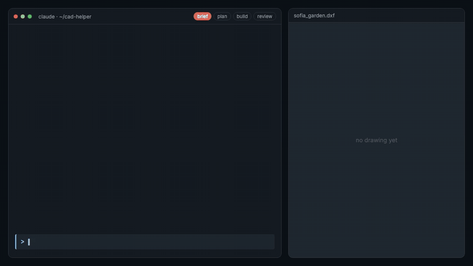

<sub>The conversation is condensed; the tool output (including the two failed checks) and
both drawings are the real ones that produced [`projects/sofia_garden`](projects/sofia_garden).
Animated with Remotion, source in [`docs/demo`](docs/demo).</sub>

cad-helper pairs a coding agent ([Claude Code](https://claude.com/claude-code), or any
agent that reads [`AGENTS.md`](AGENTS.md)) with a small Python drawing library. The agent
does the landscape-design work: it interviews you, writes a plan, and turns the plan into
a build script. The library draws, renders a preview the agent looks at before replying,
and measures the result against rules such as "fire pit at least 3 m from any tree crown".

The output is a normal DXF (R2010, millimetres, one layer per element type) that opens in
AutoCAD 2010+ and any other CAD program that reads DXF.

## What makes it trustworthy

- **The agent can't draw freehand.** Every line comes from a tested library function:
  trees, ponds, stepping stones, fences with gates, real AutoCAD dimensions.
- **Every build is checked.** `cad-helper build` runs ezdxf's DXF audit, finds anything
  outside the site, and measures clearances between layers on the real outlines (not
  bounding boxes). It exits non-zero on any error, so the agent has to fix the design.
- **The agent looks at its work.** Each build writes `preview.png`. The agent opens it
  and checks what rules can't: labels colliding, a path that leads nowhere.
- **Reviews record what was actually found.** When the checker was added to this repo it
  found real defects in every existing example project, among them 8 chairs drawn inside
  tables, shrubs planted on the far side of a fence and a maple standing in the pond. Each
  project's `review.md` lists what was found and how it was fixed.

What the checker caught during the demo:

```
$ uv run cad-helper build sofia_garden
Checks: 2 error(s), 0 warning(s)
  [error] clearance: FIRE_PIT <-> NIWAKI is 1549 mm, needs >= 3000 mm (sparks vs pine crown)
  [error] clearance: FIRE_PIT_SEATING <-> POND* is 0 mm, needs >= 300 mm (bench stays on dry ground)
```

## Get started

You need:

- a Claude subscription (Pro or Max) or an Anthropic API key, for Claude Code
- AutoCAD 2010 or newer, or any DXF viewer (BricsCAD, DraftSight, LibreCAD, Autodesk Viewer)
- macOS, Linux or Windows. No Python knowledge needed.

### 1. Install the tools (once)

```bash
# Claude Code: https://docs.claude.com/en/docs/claude-code/setup
curl -fsSL https://claude.ai/install.sh | bash

# uv, which installs the right Python and dependencies by itself
curl -LsSf https://astral.sh/uv/install.sh | sh
```

On Windows, run `irm https://claude.ai/install.ps1 | iex` and
`powershell -ExecutionPolicy ByPass -c "irm https://astral.sh/uv/install.ps1 | iex"` in PowerShell.

### 2. Get the project and open it in Claude Code

```bash
git clone https://github.com/vinter-man/cad-helper.git
cd cad-helper
uv sync
claude
```

The first time, Claude Code asks you to log in with your Claude account. The repo ships
a `.claude/settings.json` that pre-approves the build and test commands, so you won't be
asked about each one.

### 3. Describe your garden

Write what you want, in any language. The agent asks the questions a designer would ask
before drawing: where north is, who uses the garden, privacy, upkeep. Answer them in one
message.

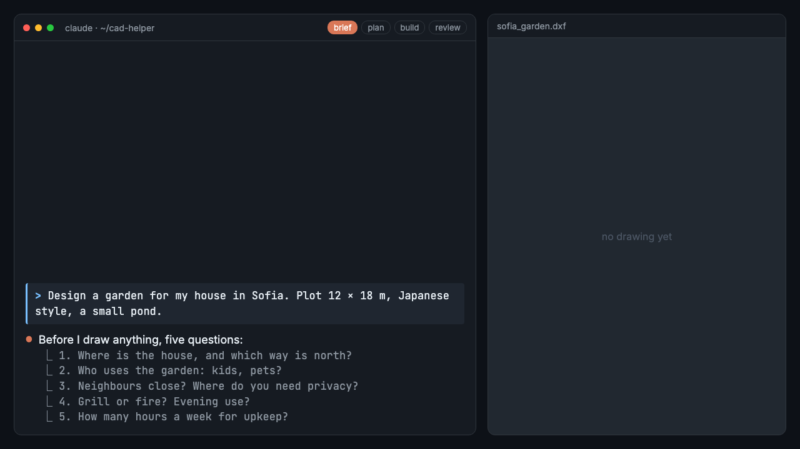

### 4. Get the drawing

The agent writes a plan, builds the DXF, checks it, looks at the preview and tells you
where the file is: `projects/<name>/<name>.dxf`.

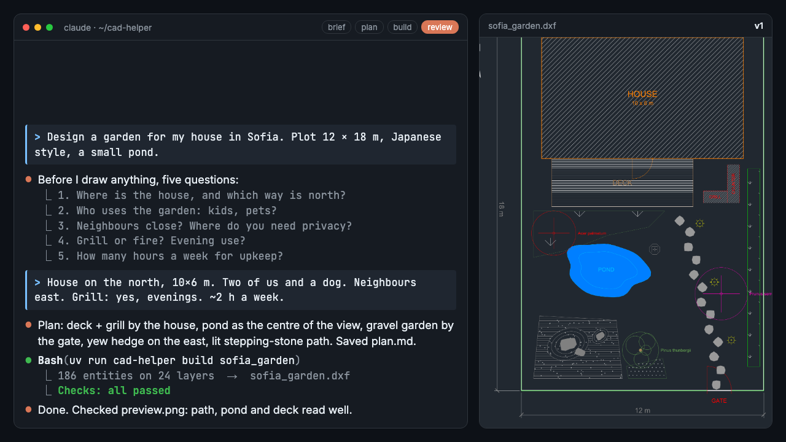

Open it in AutoCAD with **File → Open** and switch *Files of type* to **DXF (\*.dxf)**.
Units are millimetres and the origin is the south-west corner of the plot. Each element
type is on its own layer, so you can switch planting off or recolour the paths in the
Layer Properties Manager:

```
$ uv run cad-helper layers projects/sofia_garden/sofia_garden.dxf
LAYER                    COLOR LINETYPE     ENTITIES
BBQ                          1 Continuous          6
FIRE_PIT                    30 Continuous          4
FIRE_PIT_SEATING            33 Continuous          4
HEDGE_TAXUS                  3 Continuous          2
MAPLE                        1 Continuous          5
POND                       140 Continuous          3
STEPPING_STONES              8 Continuous         26
...
```

### 5. Ask for changes

"Move the bench 2 m west", "bigger pond", "add a fire pit". The agent edits the build
script, rebuilds and re-checks. If a change breaks a rule, it fixes the layout and tells
you what it moved.

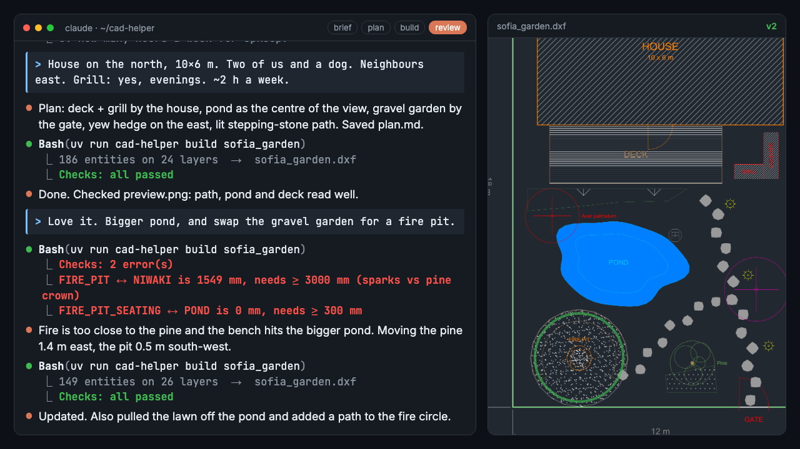

## Example projects

Each folder has the brief, the plan, the build script, the review and a preview.

| | |
|---|---|
| [**Japanese garden**](projects/backyard), 25 x 40 m<br>Koi pond fed by a stream, karesansui, tea garden behind a bamboo fence, three stepping-stone routes.<br><br>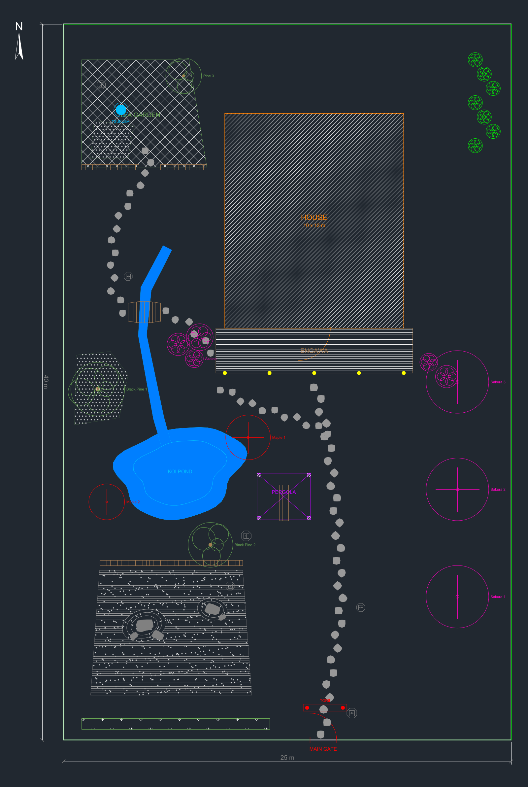 | [**Sofia garden**](projects/sofia_garden), 12 x 18 m<br>The demo project: pond, deck with grill, fire circle, yew screen.<br><br>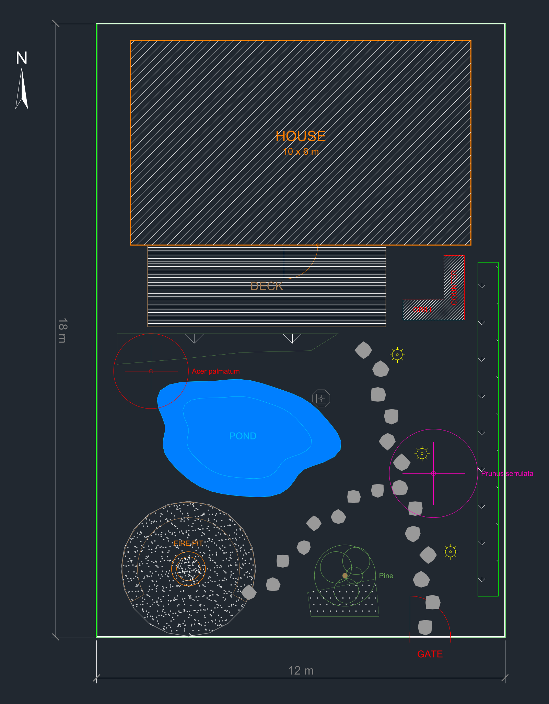 |
| [**Bar patio**](projects/bar_patio), Veliko Tarnovo, 4 x 4 m<br>Evening terrace: vines in troughs, opuntia, bistro tables, a 1 m aisle to the door.<br><br>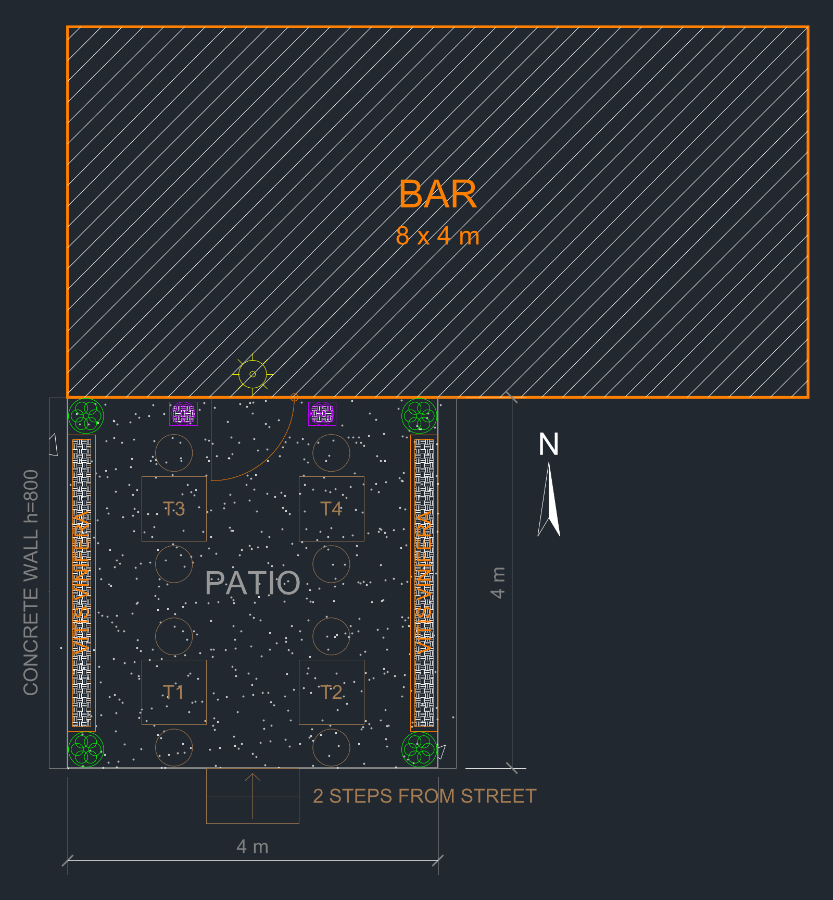 | [**Playground**](projects/playground), Sofia, 8 x 8 m<br>Three rubber-surfaced islands joined by bridges, sound barrier towards the road.<br><br>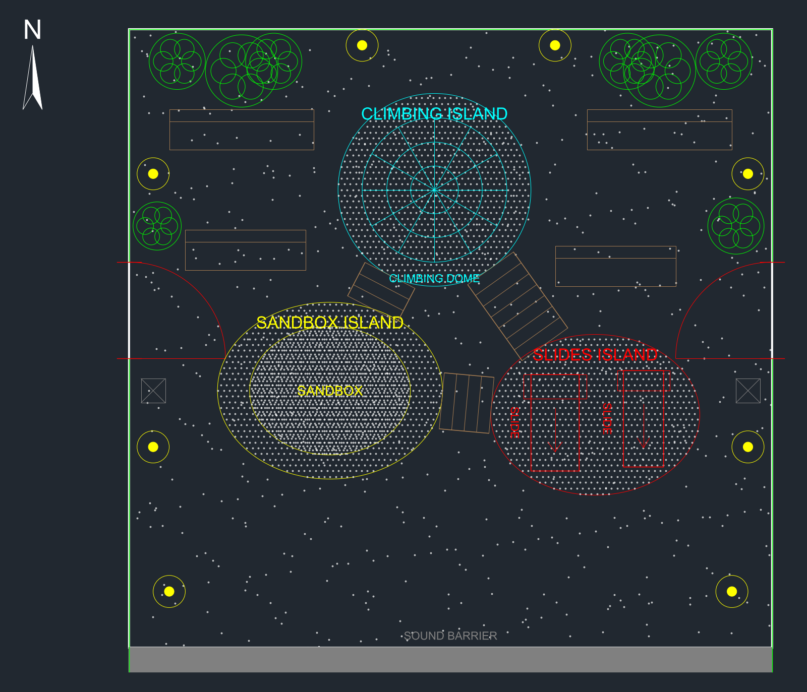 |

[**School alley**](projects/school_alley), Sofia, 3 x 50 m: about 4,700 tiles (cut tiles included) in five
sizes, graded from light in the centre to dark at the edges, with seating pockets at
both ends.

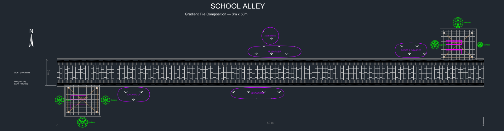

## Tile layouts without the agent

Paving plans with cut tiles at the edges and a count per tile size, for ordering material:

```bash
$ uv run cad-helper tiles herringbone --width 2000 --length 4000 --tile 300x100 --preview
Created: herringbone_300x100.dxf
  TILE_H           full   113   cut   23
  TILE_V           full   107   cut   35
```

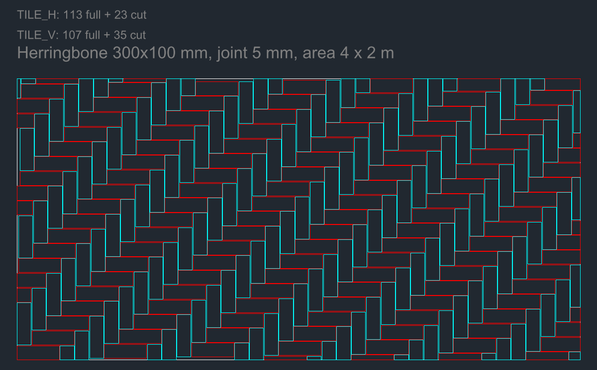

Patterns: `grid` (add `--offset` for running bond), `herringbone`, `paving` (mixed sizes
in courses, e.g. `--tiles 600x600,600x300,300x300`) and `border` (soldier-course edging,
`--rows 2`).

## How it works

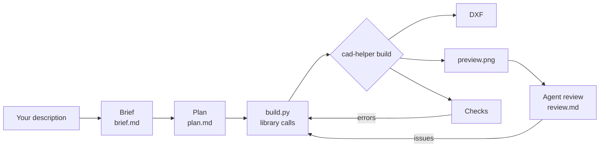

The workflow lives in a Claude Code skill,
[`.claude/skills/landscape-design`](.claude/skills/landscape-design/SKILL.md). It holds
the interview question bank, plan template, review checklist and the API reference, and
the agent loads it only when it is designing. [`AGENTS.md`](AGENTS.md) holds the rules
every agent follows.

A project is a plain Python file:

```python
from cad_helper.checks import Clearance
from cad_helper.core import create_document
from cad_helper.planting import draw_tree
from cad_helper.site import draw_plot
from cad_helper.water import draw_pond

PLOT_W, PLOT_L = 12_000, 18_000               # millimetres
BOUNDS = (0, 0, PLOT_W, PLOT_L)               # nothing may leave the plot
CLEARANCES = [Clearance("HOUSE", "POND*", 3_000, "water away from foundations")]

def build():
    doc = create_document()
    msp = doc.modelspace()
    draw_plot(msp, doc, width=PLOT_W, length=PLOT_L)
    draw_pond(msp, doc, cx=4_300, cy=5_900, rx=2_600, ry=1_700, rotation=-8)
    draw_tree(msp, doc, cx=1_600, cy=7_800, crown_diameter=2_200, label="Acer palmatum")
    return doc
```

### Commands

| Command | What it does |
|---|---|
| `cad-helper new <name> --width W --length L` | Create `projects/<name>/build.py` from a template |
| `cad-helper build <name>` | Write the DXF and `preview.png`, run the checks (exits 1 on errors) |
| `cad-helper render <file.dxf>` | PNG preview of any DXF, dark or `--theme light` |
| `cad-helper check <file.dxf> --bounds x0,y0,x1,y1` | Checks on any DXF |
| `cad-helper layers <file.dxf>` | Layer table with colour and entity count |
| `cad-helper tiles <pattern> ...` | Standalone tile layout with quantities |

Run them with `uv run` in front, or activate `.venv`.

### What the library draws

Site: plot, house with door swing, fence with gates, walls, steps, north arrow,
dimensions · Zones: hatched areas · Paths: curved paved paths, stepping stones ·
Furniture: benches, tables with chairs, pergola, grill, fire pit · Planting: trees,
shrubs, hedges, flower beds, lawn, planters, moss · Japanese: karesansui with raked
gravel, stone lanterns, tsukubai, torii, niwaki, bamboo fence · Water: ponds, streams,
bridges · Lighting · Playground equipment. Full list:
[API reference](.claude/skills/landscape-design/api.md).

## Development

```bash
uv sync
uv run pytest            # geometry, patterns, checks, CLI; builds every example project
uv run ruff check . && uv run ruff format --check .
```

CI runs the same on Python 3.11 to 3.13, builds every example project and uploads the
DXF files as an artifact.

To regenerate the demo GIF and screenshots (needs Node 20+ and ffmpeg):

```bash
cd docs/demo && npm install && npm run gif && npm run stills
```

## License

[MIT](LICENSE)
