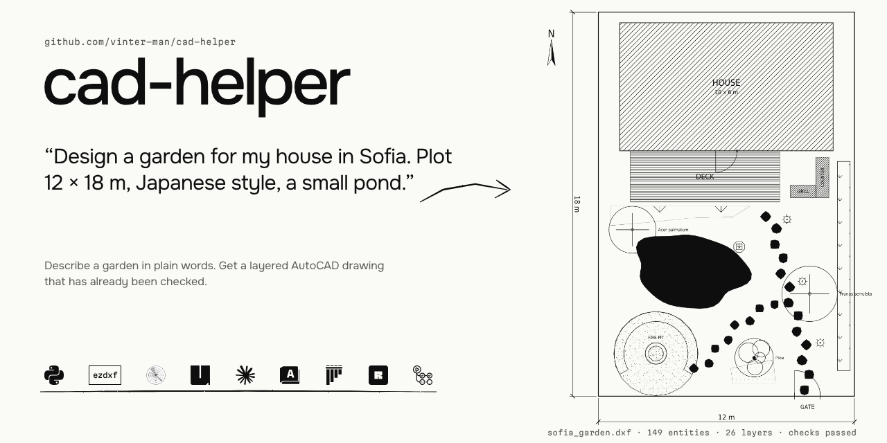
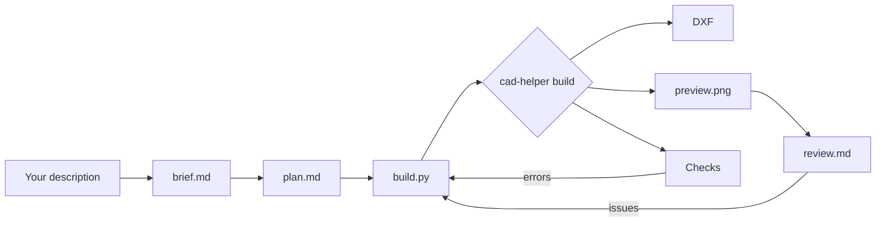
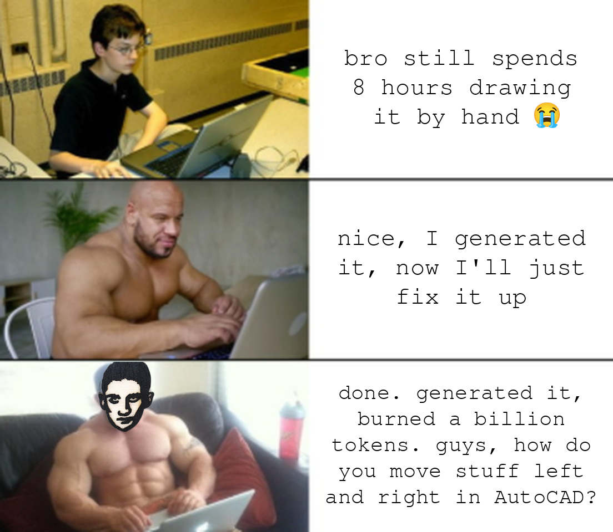

* 🌱 Started March 2026
* 🚪 Release v0.2.0
* 📐 Output: DXF R2010, millimetres, opens in AutoCAD 2010+
* 🧪 [](https://github.com/vinter-man/cad-helper/actions/workflows/ci.yml) on every push



## Short description

You tell an AI agent about your plot in plain words. It asks the questions a landscape
designer would ask, writes a plan and draws it as a real AutoCAD file with proper layers.

Don't like something? Say "bigger pond" and get the next version.

The agent doesn't draw lines by itself. It writes a small Python script that calls a tested
drawing library, then the library builds the DXF, renders a preview and measures the
result against rules like "fire pit at least 3 m from any tree". If a rule breaks, the
build fails and the agent has to fix the layout before it can say "done".


---

## Table of contents

* [User guide](#user-guide)
  * [Install](#install)
  * [Describe your project](#describe)
  * [Get the drawing](#drawing)
  * [Ask for changes](#changes)
  * [Tile layouts](#tiles)
* [Examples](#examples)
* [Under the hood](#hood)
* [Commands](#commands)
* [Contact](#contact)

---
---

## <a name="user-guide"></a> User guide

### <a name="install"></a> Install

You need three things:

* an agent subscription ([Claude Code](https://docs.claude.com/en/docs/claude-code/setup) works out of the box, anything that reads `AGENTS.md` will do)
* AutoCAD 2010+ or any DXF viewer (BricsCAD, DraftSight, LibreCAD, Autodesk Viewer)
* macOS, Linux or Windows

Install the agent and [uv](https://docs.astral.sh/uv/) once. uv pulls the right Python by itself, so no Python knowledge needed

```bash
curl -fsSL https://claude.ai/install.sh | bash        # Claude Code, as an example
curl -LsSf https://astral.sh/uv/install.sh | sh       # uv
```

> On Windows, PowerShell: `irm https://claude.ai/install.ps1 | iex` and `powershell -ExecutionPolicy ByPass -c "irm https://astral.sh/uv/install.ps1 | iex"`

Clone, install, start the agent

```bash
git clone https://github.com/vinter-man/cad-helper.git
cd cad-helper
uv sync
claude
```

### <a name="describe"></a> Describe your project

Just write what you want. Russian, Bulgarian, English, whatever. It doesn't jump straight into drawing, first come the questions: where is north, who uses the garden, neighbours, upkeep


I answer everything in one message and go make coffee

> :suspect: Under the hood the answers go to `projects/<name>/brief.md`, then the agent writes `plan.md`: zones, every element with its coordinates, plants picked for the climate, and the distance rules the drawing must respect.
>
> The whole process (interview, plan template, review checklist, API reference) is a Claude Code skill in [`.claude/skills/landscape-design`](.claude/skills/landscape-design/SKILL.md), loaded only when there is design work to do.

### <a name="drawing"></a> Get the drawing

Coffee is ready, so is the drawing


The file is in `projects/<name>/<name>.dxf`. In AutoCAD: **File → Open**, switch *Files of type* to **DXF (\*.dxf)**. Millimetres, origin in the south-west corner of the plot.

Every element type sits on its own layer, so switching off the planting or recolouring paths is two clicks in the Layer Properties Manager

```
$ uv run cad-helper layers projects/sofia_garden/sofia_garden.dxf
LAYER                    COLOR LINETYPE     ENTITIES
BBQ                          1 Continuous          6
FIRE_PIT                    30 Continuous          4
FIRE_PIT_SEATING            33 Continuous          4
HEDGE_TAXUS                  3 Continuous          2
MAPLE                        1 Continuous          5
POND                       140 Continuous          3
STEPPING_STONES              8 Continuous         26
...
```

> :godmode: `cad-helper build` does three things in one go:
> - saves the DXF (R2010, mm, AutoCAD linetypes and dimension styles inside)
> - renders `preview.png`, and the agent actually opens it and looks before replying. Rules catch geometry, only the picture shows labels on top of each other or a path that goes nowhere
> - runs the checks: DXF audit, nothing leaves the plot, nothing on layer 0, readable text, and minimum distances between layers measured on the real outlines, not on bounding boxes
>
> Any error and the command exits with code 1. The agent can't pretend it's fine.

### <a name="changes"></a> Ask for changes

"Move the bench 2 m west", "bigger pond", "swap the gravel garden for a fire pit". Here it got two errors on the first try and fixed them itself


```
$ uv run cad-helper build sofia_garden
Checks: 2 error(s), 0 warning(s)
  [error] clearance: FIRE_PIT <-> NIWAKI is 1549 mm, needs >= 3000 mm (sparks vs pine crown)
  [error] clearance: FIRE_PIT_SEATING <-> POND* is 0 mm, needs >= 300 mm (bench stays on dry ground)
```

> :hurtrealbad: These rules live in the project file and the agent writes them from the plan, before drawing
> ```python
> CLEARANCES = [
>     Clearance("FIRE_PIT", "NIWAKI", 3_000, "sparks vs pine crown"),
>     Clearance("HOUSE", "POND*", 3_000, "water away from foundations"),
> ]
> ```
> When the checker first appeared in this repo, it found real mistakes in every old example: 8 chairs drawn inside tables, shrubs planted behind the fence, a maple growing in the middle of a pond. Each project's `review.md` says what was found and fixed.

### <a name="tiles"></a> Tile layouts

Sometimes you just need paving. No agent needed, one command, and you get cut tiles at the edges plus a count per tile size, ready for ordering

```
$ uv run cad-helper tiles herringbone --width 2000 --length 4000 --tile 300x100 --preview
Created: herringbone_300x100.dxf
  TILE_H           full   113   cut   23
  TILE_V           full   107   cut   35
```


Also `grid` (with `--offset` it is running bond), `paving` (mixed sizes in courses, `--tiles 600x600,600x300,300x300`) and `border` (edging, `--rows 2`)

> :rage1: The old "herringbone" here was not a herringbone at all, and mixed paving drew 600x600 tiles as 600x300. Now it is a proper lattice with cuts at the edges, and tests check that tiles never overlap and cover the whole area.

---

## <a name="examples"></a> Examples

Each folder has the brief, plan, build script, review and preview. Three of them are real client jobs

| | |
|---|---|
| [**Japanese garden**](projects/backyard), 25 x 40 m<br>Koi pond fed by a stream, karesansui, tea garden behind a bamboo fence.<br><br> | [**Sofia garden**](projects/sofia_garden), 12 x 18 m<br>The project from the gif: pond, deck with grill, fire circle, yew screen.<br><br> |
| [**Bar patio**](projects/bar_patio), Veliko Tarnovo, 4 x 4 m<br>Evening terrace: vines in troughs, opuntia, bistro tables, a 1 m aisle to the door.<br><br> | [**Playground**](projects/playground), Sofia, 8 x 8 m<br>Three rubber islands joined by bridges, sound barrier towards the road.<br><br> |

[**School alley**](projects/school_alley), Sofia, 3 x 50 m: about 4,700 tiles in five sizes, light in the centre, dark at the edges, seating pockets at both ends


---

## <a name="hood"></a> Under the hood



A project is a plain Python file, nothing magical

```python
from cad_helper.checks import Clearance
from cad_helper.core import create_document
from cad_helper.planting import draw_tree
from cad_helper.site import draw_plot
from cad_helper.water import draw_pond

PLOT_W, PLOT_L = 12_000, 18_000               # millimetres
BOUNDS = (0, 0, PLOT_W, PLOT_L)               # nothing may leave the plot
CLEARANCES = [Clearance("HOUSE", "POND*", 3_000, "water away from foundations")]

def build():
    doc = create_document()
    msp = doc.modelspace()
    draw_plot(msp, doc, width=PLOT_W, length=PLOT_L)
    draw_pond(msp, doc, cx=4_300, cy=5_900, rx=2_600, ry=1_700, rotation=-8)
    draw_tree(msp, doc, cx=1_600, cy=7_800, crown_diameter=2_200, label="Acer palmatum")
    return doc
```

> :shipit: The library is `src/cad_helper` on top of [ezdxf](https://github.com/mozman/ezdxf): site, house, fences with gates, walls and steps, zones, paths, stepping stones, furniture, fire pit, trees, hedges, beds, planters, ponds, streams, bridges, karesansui, lanterns, torii, niwaki, lighting, playground equipment. Full list in the [API reference](.claude/skills/landscape-design/api.md).
>
> `uv run pytest` covers geometry, tile patterns, checks, the CLI, and builds every example project. CI runs it on Python 3.11 to 3.13 and uploads the built DXF files as an artifact.
>
> The gif is a [Remotion](https://www.remotion.dev/) composition in [`docs/demo`](docs/demo) that replays a real build session, `npm run gif` to regenerate.

---

## <a name="commands"></a> Commands

Put `uv run` in front of each

| Command | What it does |
|---|---|
| `cad-helper new <name> --width W --length L` | new `projects/<name>/build.py` from a template |
| `cad-helper build <name>` | DXF + `preview.png` + checks, exit 1 on errors |
| `cad-helper render <file.dxf>` | PNG preview of any DXF, `--theme light` if you like |
| `cad-helper check <file.dxf> --bounds x0,y0,x1,y1` | checks on any DXF |
| `cad-helper layers <file.dxf>` | layer table with colour and entity count |
| `cad-helper tiles <pattern> ...` | tile layout with quantities |

---

## <a name="contact"></a> Contact

GitHub: [vinter-man](https://github.com/vinter-man)

License: [MIT](LICENSE), take it and draw

---



> :trollface: `M`, Enter, select, Enter, base point, second point. Saved you a billion tokens
